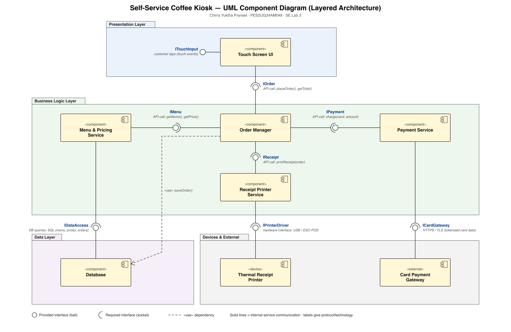

# SE Lab 3 — Component Modelling & Architectural Pattern Selection

**Chirra Yuktha Praneel · PES2UG24AM049 · Section A**

Scenario: **Self-Service Coffee Kiosk** (3 coffee types, 2 sizes, card-only payment, printed receipt).

Chosen architecture: **Layered** (Presentation → Business Logic → Data, with hardware/external adapters).

| File | Deliverable |
|------|-------------|
| `Lab3/Lab3_Component_Diagram.png` / `.pdf` | UML component diagram — 8 components, 7 provided/required interfaces (ball-and-socket), protocol labels |
| `Lab3/Lab3_Component_Diagram.svg` | Editable source of the diagram |
| `Lab3/Lab3_Justification_PES2UG24AM049.pdf` / `.docx` | One-page justification: choice, two reasons, security advantage, performance benefit |

